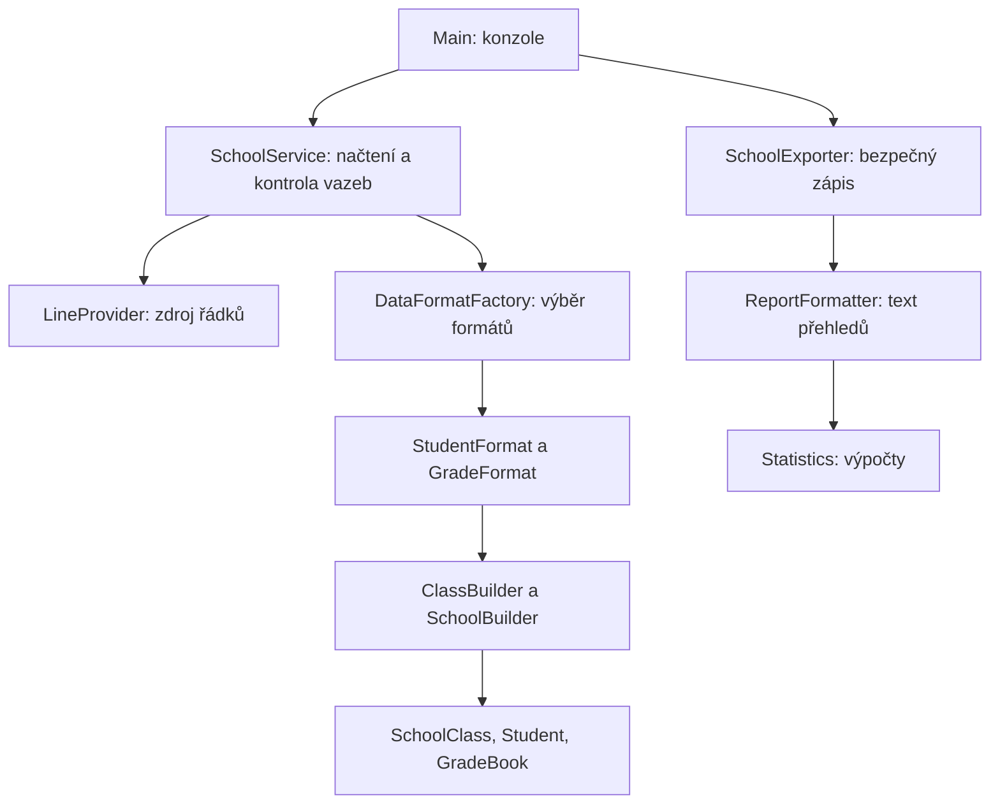

# Dokumentace — T18_cviceni-CSV

Skupina T18, předmět Pokročilé programovací techniky. Implementace podle obou přiložených textových zadání, jejichž kopie jsou ve složce `zadani/`.

## Splnění požadavků

| Požadavek | Realizace |
|---|---|
| Seznamy studentů ve třech formátech | `CsvStudentFormat`, volba `i`, `ii`, `iii` |
| Víceslovná jména i příjmení | Samostatné položky; nedělí se podle mezer |
| Libovolný počet tříd a klasická pole studentů | `SchoolBuilder`, `ClassBuilder`, `SchoolClass.students()`; pole se podle potřeby zvětšují |
| Známky v mapě | `GradeBook`: mapa tříd, pořadových čísel a map `Subject → Integer` |
| Tři formáty známek | `CsvGradeFormat`: blokový, s počtem, položky na samostatných řádcích |
| Pevné i libovolné pořadí předmětů | Pevné pořadí MAT, FYZ, IT, TV, CJ; pojmenované dvojice s příponou `-named` |
| Soubor pro každou třídu ve stejném formátu | `SchoolExporter` využije původní `StudentFormat.serialize` |
| Pořadová čísla studentů | Přiděluje Builder od 1 v každé třídě; jsou uvedena ve výsledném přehledu |
| Prospěch studenta a průměry třídy po předmětech | Čistá výpočetní třída `Statistics`, výstupy `prehledy/studenti.csv` a `prehledy/tridy.csv` |
| Provider, Builder, Factory a oddělení odpovědností | Viz následující návrh |
| Chybové stavy | Vlastní `DataFormatException`, standardní I/O výjimky, přesné zprávy konzole |
| Další formáty, např. XML | Registrovatelné implementace `StudentFormat` a `GradeFormat`; bez změny služby |

## Architektura a odpovědnosti

**Prezentační vrstva**: `Main` přijme parametry, vypíše výsledek nebo srozumitelnou chybu a nastaví návratový kód (0 úspěch, 1 chyba dat/I/O, 2 špatný počet argumentů). Neparsuje známky ani nepočítá průměry.

**Logická vrstva**: formátové strategie parsují text bez souborových operací. `SchoolService` řídí načtení a ověří shodu tříd a počtů. `Statistics` pouze počítá. `ReportFormatter` pouze sestavuje přehled. Builder při konstrukci kontroluje platná jména a přiřazuje čísla.

**Datová vrstva**: neměnné záznamy `Student`, `SchoolClass` a `GradeBook`. Pole se obranně kopírují, vnořené mapy nejsou zvenku modifikovatelné. Studenti nejsou uloženi v ArrayList; Builder i výsledný model používají klasická pole.

**I/O infrastruktura**: `Utf8FileProvider` čte UTF-8, `SchoolExporter` zapisuje. Parser nezná cesty souborů, výpočty neznají textový formát, model nezná konzoli.

## Návrhové vzory

- **Provider**: `LineProvider` definuje zdroj textových řádků. Výchozí implementace čte soubor; test může dodat vlastní řádky nebo simulovat odmítnutí přístupu.
- **Builder**: `ClassBuilder` postupně tvoří pole studentů a přiděluje čísla; `SchoolBuilder` tvoří pole tříd a odmítá duplicitní názvy. `build()` vrací hotová data s obrannými kopiemi.
- **Factory**: `DataFormatFactory` vrací odpovídající formát a nabízí `registerStudents` / `registerGrades`. Výběr je mimo aplikační službu.
- **Strategy**: rozhraní `StudentFormat` a `GradeFormat` oddělují konkrétní interpretaci dat. Nový XML formát by implementoval parse/serialize a příponu `extension()`, pak by se registroval do Factory. XML parser není součástí požadovaných CSV variant; rozšiřitelnost je ověřena testem nového registrovaného formátu s vlastní příponou.

## Pravidla souborů a zpracování

Formát se volí explicitně, aby aplikace nemusela hádat nejednoznačný obsah. U formátu i odděluje třídy prázdný řádek. U ii a iii se čte přesně deklarovaný počet záznamů. Prázdné řádky jsou povoleny mezi třídami, nikoli uvnitř záznamu. UTF-8 BOM na začátku a okolní mezery jsou podporovány. Pořadí tříd může být v obou souborech jiné, označení třídy se musí shodovat přesně.

Jméno a příjmení se u i/ii oddělí středníkem, u iii hranicí řádku; vnitřní mezery se zachovávají. Jde o přesně zadaný jednoduchý formát, nikoli obecný CSV standard s uvozovkami a escapovanými středníky. Středník uvnitř jména není povolen.

Pevný záznam známek musí obsahovat právě pět celých čísel 1 až 5. Pojmenovaný záznam musí obsahovat každý známý předmět právě jednou, libovolně uspořádaný. Chybí-li předmět, je duplicitní či neznámý, parser odmítne soubor. Číslo studenta odpovídá pořadí jeho sady známek uvnitř dané třídy.

Před exportem se ověří přesná množina tříd i počet sad známek pro každou třídu. Zkratky tříd obsahují jen písmena, číslice, podtržítko a pomlčku; nesmějí být rezervovaným názvem zařízení Windows. Duplicitní zkratky se odmítají i bez rozlišení velikosti písmen, aby nevznikla kolize souborů na Windows.

Export nejprve vytvoří pomocnou složku vedle cíle. Teprve po úspěšném zápisu všech souborů ji přesune na cílové jméno. Při chybě rozpracovanou složku uklidí. Existující cíl se nepřepisuje; předchozí výsledky zůstanou zachovány. Nejde o databázovou transakci ani garanci proti výpadku proudu.

## Výpočty

Studentův průměr je součet pěti známek dělený pěti. Prospěch je `NEPROSPĚL`, pokud je alespoň jedna známka 5, jinak `PROSPĚL`. Zadání neurčuje pravidla vyznamenání ani hodnocení chování, proto je aplikace nepředpokládá. Třídní průměr v předmětu zahrnuje všechny studenty třídy; prázdná třída má v přehledu pomlčku. Zaokrouhlení na dvě desetinná místa nastává až při formátování.

Ukázková 7A: Anna Marie Nováková má známky 1, 2, 1, 3, 1 a průměr **1,60**. Jan Van der Berg má 5, 3, 2, 1, 2, průměr **2,60** a neprospěl. Třída má průměry **MAT 3,00; FYZ 2,50; IT 1,50; TV 2,00; CJ 1,50**. Tato očekávání jsou pevně zapsána v integračních testech.

## Testování a výsledky

**64 testů prošlo, 0 chyb, 0 přeskočených.** Ověřeno na OpenJDK 17.0.20, Maven 3.9.9, JUnit 5.10.2 v Linuxu. Protokol je v `Vysledky_testu.txt`; skutečný ukázkový běh JARu je v `Ukazka_spusteni.txt`. Spouštění Windows skriptu v tomto prostředí nebylo přímo ověřeno.

| Oblast | Ověření |
|---|---|
| Všechny vstupní varianty | 18 kombinací tří formátů studentů a šesti formátů známek |
| Export a zpětné načtení | Tři varianty seznamu, stejné pořadí a jména, přesné výsledky obou přehledů |
| Chybné seznamy | Prázdný vstup, chybějící položka, nesprávný počet polí/studentů, negativní a příliš velký počet, duplicity a neplatný název třídy |
| Chybné známky | Příliš málo/mnoho známek, čísla mimo 1–5, nečíselná známka, chybějící, duplicitní či neznámé předměty, nedokončený vstup |
| Nesoulad mezi soubory | Jiný počet studentů a sad, chybějící či neznámá třída |
| I/O | Neexistující soubor, odmítnutý přístup přes testovací Provider, neplatné UTF-8 |
| Hraniční stavy | BOM, mezery, víceslovná jména, prázdná třída, rostoucí pole (40 tříd po 70 studentech) |
| Návrh | Ochrana polí a map, rozšíření Factory o nový formát bez změny služby |
| Export při chybě | Odmítnutí existujícího cíle, úklid částečně vytvořeného exportu |
| Konzole | Úspěch, chybný počet argumentů, chybějící soubor a správné návratové kódy |

Odmítnutí oprávnění se testuje pomocí Provideru, který vyvolá `AccessDeniedException`; test je deterministický i pod administrátorským účtem. Nejde o předstíraný úspěch nativního testu oprávnění. Chybné UTF-8, neexistující soubor a exportní operace jsou ověřeny nad skutečnými dočasnými soubory.

## Postup práce a omezení

1. Rozdělení požadavků na model, parsování, kontrolu vazeb, statistiky, export a konzoli.
2. Návrh rozhraní Provider/Strategy a Builderů používajících pole.
3. Implementace tří variant seznamů a šesti variant známek.
4. Doplnění kontroly počtů, předmětů a I/O výjimek.
5. Implementace přehledů a exportu bez přepisování existujícího cíle.
6. Parametrizované a integrační testy, sestavení JARu a skutečný běh nad ukázkovými daty.

Soubory se načítají celé do paměti. „Libovolný počet“ tedy znamená bez pevně zakódovaného počtu tříd, s běžným omezením paměti JVM. XML je připravené rozšiřujícím rozhraním, nikoli implementované bez požadavku. Změna pravidel prospěchu patří do `Statistics`, nový zdroj do Provideru, nový textový formát do Factory/Strategy.

## Spouštěč Windows

`spustit.bat` hledá `java.exe` nejprve v JDK stažených přes IntelliJ (`%USERPROFILE%\.jdks\*\bin\java.exe`), poté v JAVA_HOME a PATH. `pushd` obslouží i UNC cesty. Spouští přímo přiložený JAR a zachová chybový výstup v okně. Tato změna řeší stav, kdy Java funguje v IDE, ale příkaz java není známý systému. Java 17 nebo novější musí být v počítači dostupná. Samotný BAT nebyl v Linuxovém ověřovacím prostředí spuštěn pod Windows; JAR a funkční testy byly ověřeny samostatně.
