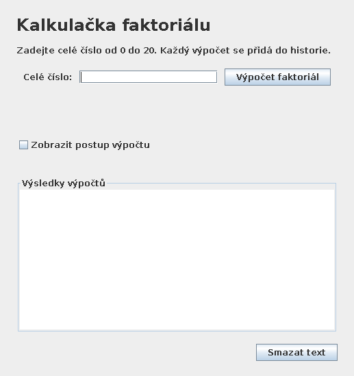
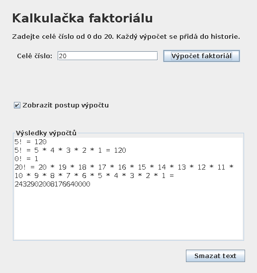
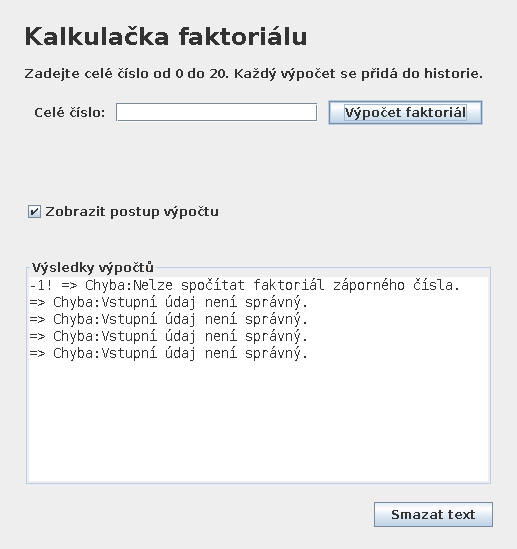
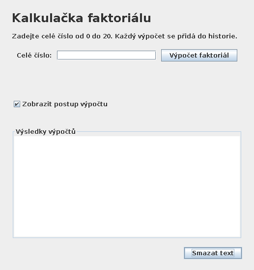

# T18_ukol-03 — Dokumentace

## Zadání a výsledek

<strong>Skupina T18 · Úkol 03 · 4. listopadu 2026</strong>

Byla vytvořena desktopová aplikace „Kalkulačka faktoriálu“ v Javě 17 s knihovnou Swing. Jedno textové pole přijímá celé číslo; tlačítko „Výpočet faktoriál“ spouští výpočet. Víceřádkový výstup zachovává předchozí výsledky a přidává každý požadavek na nový řádek. Volba „Zobrazit postup výpočtu“ doplní součin činitelů, tlačítko „Smazat text“ vymaže výstup i datovou historii. Výpočet lze spustit také Enterem ze vstupního pole.

## Návrh tří vrstev

<table><tr><th>Vrstva</th><th>Třídy</th><th>Odpovědnost</th></tr><tr><td>Prezentační</td><td>CalculatorPanel</td><td>Swing komponenty, zpracování kliknutí, zobrazení vráceného výstupu. Neprovádí matematický výpočet.</td></tr><tr><td>Logická</td><td>MyMath, FactorialService</td><td>Faktoriál, převod vstupu, zachycení očekávaných výjimek, sestavení výstupního řádku a předání záznamu historii.</td></tr><tr><td>Datová</td><td>CalculationRecord, CalculationHistory</td><td>Neměnný záznam výsledku a seznam historie v paměti. Nezávisí na Swingu ani na logické vrstvě.</td></tr></table>
<code>Main</code> je vstupní bod a místo sestavení závislostí. Vytváří historii, předá ji službě a službu předá panelu. Závislosti směřují z prezentace do logiky a z logiky do dat. Datová vrstva nezná žádnou vyšší vrstvu. Její metoda <code>records()</code> vrací neměnnou kopii, takže klient nemůže změnit vnitřní seznam.

Okno vzniká a události se zpracovávají na Swing Event Dispatch Thread. Výpočet má nejvýše 19 násobení, proto zde není nutné zavádět práci na pozadí.

## Algoritmus, rozsah a výjimky

Metoda <code>MyMath.factorial(int n)</code> vrací <code>long</code>. Neobsahuje ovládací prvky ani textové vstupy. Inicializuje výsledek na 1 a násobí čísly od 2 do n, takže 0! i 1! jsou rovny 1. Časová složitost je O(n), pomocná paměť O(1); po kontrole rozsahu je n nejvýše 20.

Hodnota 20! = 2432902008176640000 se do <code>long</code> vejde, 21! už ne. Rozsah je proto záměrně omezen na 0–20; nepoužívá se přibližný desetinný výpočet. <code>Math.multiplyExact</code> navíc chrání samotné násobení. Postup pro 0 se nevypisuje jako součin, protože jde o prázdný součin: výstup je <code>0! = 1</code>.
<table><tr><th>Situace</th><th>Výjimka a zpracování</th><th>Výstup</th></tr><tr><td>Záporné číslo, např. −1</td><td>MyMath vyvolá IllegalArgumentException; služba ji zachytí.</td><td>−1! =&gt; Chyba:Nelze spočítat faktoriál záporného čísla.</td></tr><tr><td>Prázdný vstup, „pět“, 5.0 nebo číslo mimo int</td><td>Integer.valueOf vyvolá NumberFormatException.</td><td>=&gt; Chyba:Vstupní údaj není správný.</td></tr><tr><td>Celé číslo větší než 20</td><td>MyMath vyvolá ArithmeticException.</td><td>=&gt; Chyba:Vstupní údaj není správný.</td></tr></table>
Okolní mezery se odstraní pomocí <code>trim()</code>. Výjimky se nezamlčují v matematické metodě: volající může samostatně otestovat jejich typ. Služba převádí pouze očekávané výjimky na zprávy pro uživatele. NumberFormatException se zachytává před obecnější IllegalArgumentException, protože je jejím potomkem.

## Postup realizace

<ol><li>Byla zkontrolována stávající struktura repozitáře PPT. V aktuální verzi nebyla nalezena předchozí metoda MyMath ani testy faktoriálu; tato část byla vytvořena nově, není vydávána za převzatou z minulého úkolu.</li><li>Byl definován přesný číselný rozsah a samostatná matematická metoda včetně dokumentačního komentáře a výjimek.</li><li>Byla přidána datová historie a služba pro validaci a formátování výsledku.</li><li>Bylo vytvořeno GUI a propojeno se službou; zajištěn běh na EDT a výstup pouze pro čtení.</li><li>Byly přidány parametrizované testy a GUI scénář se skutečnými událostmi myši a klávesnice.</li><li>Aplikace byla přeložena, testy spuštěny a z reálného okna pořízeny čtyři snímky.</li></ol>

## Testování a výsledky

<strong>Výsledek ověření: 28 testů spuštěno, 28 úspěšných, 0 neúspěšných, 0 přeskočených.</strong> Kompletní protokol je přiložen v <code>Vysledky_testu.txt</code>. Běh proběhl na OpenJDK 17.0.20, JUnit 5.10.2 (JUnit Platform Console 1.10.2), Linuxu a virtuálním displeji Xvfb. GUI test ovládal zobrazené okno přes <code>java.awt.Robot</code>; všechny Swing operace a kontroly komponent probíhají na EDT.
<table><tr><th>Testovací třída</th><th>Počet</th><th>Pokrytí</th></tr><tr><td>MyMathTest</td><td>14</td><td>0, 1, 2, 5, 10, 12, 13, 20; záporné hodnoty včetně Integer.MIN_VALUE; 21, 100 a Integer.MAX_VALUE.</td></tr><tr><td>FactorialServiceTest</td><td>13</td><td>10 neplatných vstupů, postup a mezery, zpráva záporného vstupu, historie, neměnnost kopie a smazání.</td></tr><tr><td>CalculatorUiTest</td><td>1 komplexní scénář</td><td>Skutečné zadání 5 klávesnicí, klikání, přepnutí postupu, 0 a 20, záporné a neplatné vstupy, nové řádky, vymazání výstupu i historie, výpočet Enterem a výstup pouze pro čtení.</td></tr></table>
Očekávané hodnoty v testech jsou pevně zadané, nejsou počítány stejným algoritmem jako implementace. Testy ověřují přesné řetězce včetně nových řádků. GUI test se bez displeje nezamlčí: skončí s jasnou instrukcí k použití Xvfb.

## Doklady funkčnosti a diskuze

Následující snímky jsou zachyceny ze skutečně spuštěného Swing okna během automatizovaného GUI testu. Vzhled odpovídá Linuxu bez správce oken; na Windows se může lišit dekorace a vykreslení písma.

### Výchozí stav

Prázdný výstup, jedno vstupní pole a všechny požadované ovládací prvky.

### Výsledky a postup výpočtu

Ve stejné historii je jednoduchý výstup 5! = 120, rozvinutý součin, 0! a nejvyšší podporovaný faktoriál 20!. Dlouhý řádek se vizuálně zalamuje; v textu zůstává jedním záznamem ukončeným novým řádkem.

### Chybové stavy

Záporný vstup má specifickou zprávu. Text „pět“, hodnota 21, celé číslo mimo rozsah int a prázdný vstup mají obecnou chybu podle zadání. Aplikace po chybě zůstává použitelná.

### Vymazání historie

Tlačítko Smazat text odstranilo výstup. Test zároveň ověřil prázdnou datovou historii a následně úspěšný nový výpočet Enterem.

## Zhodnocení a spuštění

Rozsah 0–20 odpovídá typu long. Historie je pouze v paměti. Ověřeno na Linuxu s OpenJDK 17 a Xvfb, nikoli na Windows. Postup spuštění je v [README](../README.md). Úplná samostatná dokumentace s vloženými snímky je v [Dokumentace.html](Dokumentace.html).
